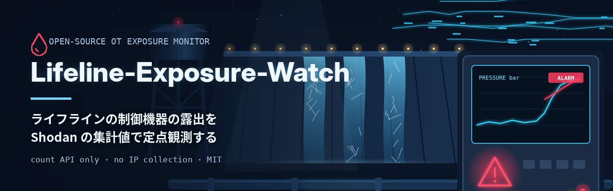

# Lifeline-Exposure-Watch

水道、電力、太陽光、ビル設備、冷蔵設備など、ライフラインにつながる制御・監視機器が、インターネットからどれだけ見える状態にあるか。それを **Shodan の集計値（count API）だけ** で定点観測するためのスクリプト集です。

2023〜2026年に世界で起きた「露出した制御機器を、初期パスワードや正規の機能で操作する」攻撃を調べた記事で、日本国内の状況を測るために作りました。

- 記事：[冷蔵庫の件を追っていたら、水道やダムも同じ手口でやられていたので調べてみた](https://qiita.com/01rabbit/)（2026-11-20 公開予定）
- 前報・続報と姉妹ツール：[ColdChain-Exposure-Watch](https://github.com/01rabbit/ColdChain-Exposure-Watch)（冷蔵設備の管理画面に特化）

## 特徴

- Shodan の `/shodan/host/count` だけを使います。検索クレジットは消費しません。
- IP アドレスやホスト名は取得しません。機器への接続、ログインの試行もしません。
- 世界の事例で狙われた機種（Unitronics、Rockwell、VNC 経由の HMI、タンク液面計、冷蔵設備）と、日本で目立つ機種（SolarView、三菱 MELSEC、オムロン、Lantronix など）を並べて数えます。
- 出力ファイルは上書きしません。公開用の加工スクリプトが付いています。

## 収録しているもの

| ファイル | 役割 |
|---|---|
| `lifeline_exposure.py` | 計測スクリプト。4つのモードがある（下表） |
| `sanitize_for_publication.py` | 計測結果から回線事業者名・都市・証明書・HTML ハッシュの値を取り除き、公開できる形にする |
| `daily_watch.py` | 主要な約30指標を毎日1回数え、JSONL に追記する定点観測用。ファセットを取らないので記録はそのまま公開できる |
| `scheduler/` | `daily_watch.py` を macOS の launchd で自動実行する設定スクリプト。毎朝の定点観測と、週1回の SolarView の版の集計（API キーはキーチェーンに保存） |
| `detection/solarview.rules` | SolarView を守る側のための Suricata ルールの例（入口の保守用画面へのアクセスと、侵入後の振る舞い）。Suricata 7.0.3 で構文と動作を確認 |
| `detection/xweb.rules` | Copeland（旧 Dixell）XWEB EVO を守る側のための Suricata ルールの例（`xwconsole.cgi`・`config.lua` への外部からのアクセスと、侵入後の振る舞い）。2026-11 公表の CVE-2026-124010／124014 を受けて追加 |
| `data/` | 記事の計測（2026-11-10）の結果。公開用に加工済み |

| モード | 問い合わせ数 | 内容 |
|---|---:|---|
| `--discover` | 3 | 日本の制御機器（`tag:ics`）の製品・ポートの内訳。クエリを調整するための下見 |
| （指定なし） | 56 | 18種類の機器について、全世界の件数と日本の順位、日本の内訳、直近16日の件数 |
| `--followup` | 23 | 制御機器のポート別内訳、BACnet・XWEB・SolarView の確認、米独韓との比較 |
| `--round3` | 17〜22 | SolarView の詳細、回線事業者の集中の確認（`CONC_ORGS` を設定したときのみ） |

## 使い方

```bash
python3 -m venv .venv && source .venv/bin/activate
pip install -r requirements.txt

# API キーは履歴に残らない方法で設定する
read -s SHODAN_API_KEY && export SHODAN_API_KEY

python3 lifeline_exposure.py --discover
python3 lifeline_exposure.py
python3 lifeline_exposure.py --followup
python3 lifeline_exposure.py --round3

# 公開用に加工する
python3 sanitize_for_publication.py jp_ot_*.json -d public/
```

`--round3` で特定の回線事業者への集中を確かめたい場合は、事業者名を環境変数で渡します。事業者名はコードにも公開データにも残しません（加工後は `<ISP-A>` などに置き換わります）。

```bash
export CONC_ORGS="Example ISP,Example ISP Inc."
python3 lifeline_exposure.py --round3
python3 sanitize_for_publication.py jp_ot_round3_*.json -d public/
```

## 毎日の定点観測（macOS）

```bash
cd scheduler
bash install_macos.sh     # ~/lifeline-watch に設置し、毎朝 7:13 に実行
bash install_weekly_sv_macos.sh   # SolarView の版の分布を毎週月曜 7:31 に集計（任意）
bash uninstall_macos.sh   # 自動実行をすべて止め、キーチェーンの API キーを削除
```

記録は `~/lifeline-watch/daily_watch.jsonl` に1日1行ずつ、版の集計は `~/lifeline-watch/sv_versions/` に週1ファイルずつたまります。

## 結果の読み方

件数は **実機の台数ではありません**。記事の計測で分かった注意点を挙げます。

- **ポート番号だけの件数は大きく水増しされる。** すべてのポートに応答するサーバーが大量に一致するためです。日本の例では、5006・5007番（三菱 MELSEC）の16,798件のうち、Shodan が制御機器と判定したのは125件でした。原則として `tag:ics` を付けた件数を使ってください。
- **おとり（ハニーポット）が混じる。** Shodan の `honeypot` タグでは除外できないものがあります。単一のホスティング事業者に集中し、多数のポートに1件ずつ散らばり、TLS がほとんどない、という特徴がそろうものは、おとりの可能性が高いと見ています。
- **応答の種類まで確かめる。** BACnet（47808番）は日本で1,895件が応答しましたが、BACnet の識別子（Instance ID）を含むものは4件でした。
- **露出していることは、脆弱であることや侵害されたことを意味しない。**
- **Shodan だけでは過去と比べにくい。** Shodan は各機器の最新の応答を中心に持つため、`after:` で分かるのは「最後に観測された時期」です。推移を見るには、このツールの定点観測を続けるか、Shadowserver のような時系列の集計と照らし合わせてください。
- **観測サービスによって件数が大きく違う。** 記事の計測では、SolarView（日本）は Shodan の製品判定で2,806件、Shadowserver の機器単位で191件でした。

## 倫理と注意

- 他人の機器への接続、ログインの試行、IP アドレスの収集には使わないでください。
- 結果を公開するときは、必ず `sanitize_for_publication.py` を通した版を使ってください。
- 特定の製品の露出を見つけた場合は、公表の前にメーカーや JPCERT/CC への共有を検討してください。

## 動作環境

- Python 3.8 以上
- `shodan` ライブラリ
- Shodan の API キー（`http.html` などのフィルタには有料プランが必要な場合があります）

## ライセンス

MIT License（Copyright (c) 2026 Mr.Rabbit）
